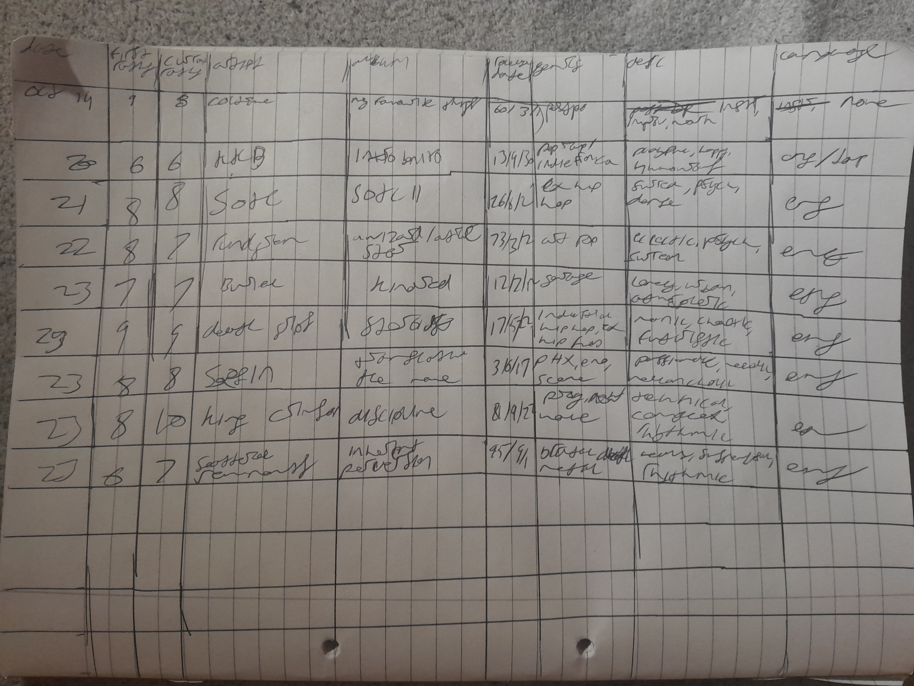

# Data Centric Programming Assignment 2026

My data will be logging my listening habits and my rating of newly discorvered albums,
I chose to record this as i wanted to see if I have any major preferences towards certain genres and themes in music.
I also wanted to see if my first impressions of an album change much upon allowing the album to sit with me for a while.

# Questions

1. Do I have any major affinities towards year or genre?
2. Do my thoughts on albums change much after the first listen?
3. How likely am I to be positive or negative towards new music?

# Data Dictionary

| Column Name | Type | Format | Measured By |
|---|---|---|---|
| Date Listened | Date | YYYY/MM/DD | Date of first listen |
| Initial Rating | Integer | 1–10 | Thoughts on first listen |
| Current Rating | Integer | 1–10 | Thoughts after 1 hour |
| Artist | String | Text | Name of artist |
| Album | String | Text | Name of album |
| Release Date | Date | YYYY/MM/DD | Release date of album |
| Genres | String | Text, comma-separated | Genre(s) associated with the album |
| Descriptors | String | Text, comma-separated | Words that describe the album |
| Language | String | Text, comma-separated | Language(s) used |

# Description of the project

Originally I planned to compile my data to paper as I collected it, this proved inefficeint so I opted to write it in my phones notes app

# Instructions for use

# How it works:

# Findings

After collecting and analysing all the data on the 36 albums,
I have found several interesting insights into how My Musical preferences and thoughts on an album shift overtime.

To answer the questions I asked at the start of this project:

Question 1. Do I have any major affinities towards year or genre?

# List of files in the project

1. Music_Data.csv
2. README.md
3. pt2.py
4. pt3.py
5. 1000031656.jpg
6. genre_ratings.png
7. music_database.db
8. rating_comparison.png
9. rating_distribution.png
10. ratings_over_time.png

# References
# What I am most proud of in the assignment
# What I learned
