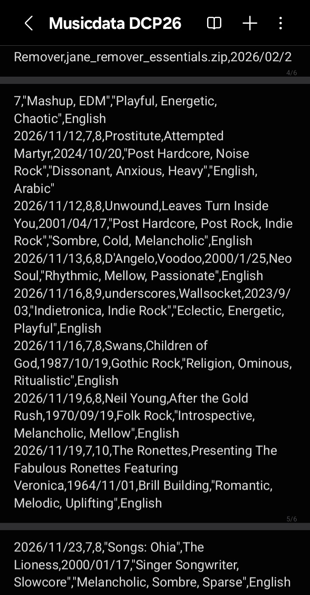

# Data Centric Programming Assignment 2026

My data will be logging my listening habits and my rating of newly discovered albums,
I chose to record this as I wanted to see if I have any major preferences towards certain genres and themes in music.
I also wanted to see if my first impressions of an album change much upon allowing the album to sit with me for a while.

# Questions

1. Do I have any major affinities towards year or genre?
2. Do my thoughts on albums change much after the first listen?
3. How likely am I to be positive or negative towards new music?

# Data Dictionary

| Column Name | Type | Format | Measured By |
|---|---|---|---|
| Date Listened | Date | YYYY/MM/DD | Date of first listen |
| Initial Rating | Integer | 1–10 | Thoughts on first listen |
| Current Rating | Integer | 1–10 | Thoughts after 1 hour |
| Artist | String | Text | Name of artist |
| Album | String | Text | Name of album |
| Release Date | Date | YYYY/MM/DD | Release date of album |
| Genres | String | Text, comma-separated | Genre(s) associated with the album |
| Descriptors | String | Text, comma-separated | Words that describe the album |
| Language | String | Text, comma-separated | Language(s) used |

# Description of the project

Originally I planned to compile my data to paper as I collected it.

This proved inefficient, so I opted to write it in my phone's notes app.

# Instructions for use

# How it works:

# Findings

After collecting and analysing all the data on the 36 albums,
I have found several interesting insights into how my musical preferences and thoughts on an album shift over time and answers to the questions I asked at the start of this project:

Question 1. Do I have any major affinities towards year or genre?

The genre I listened to the most during the data collection time frame was Post Hardcore,
which appeared as a genre in 5 albums.
Other genres that appeared frequently include Indie Rock (3 times) and Singer Songwriter (3 times).

Prog Rock had a high average score (9.5) but I only listened to 2 albums from that genre.

The years 2026, 2000, and 1981 were the most frequent years,
each appearing 3 times.

I don't believe I can say with confidence that I have any particular preference towards a certain time period as the data is spread across 1960 to 2026.
Overall the data would suggest that i tend to enjoy a variety of genres and time periods,
lacking an obvious preference.

Question 2. Do my thoughts on albums change much after the first listen?

Of the 36 albums i listned to:\
18 stayed at the same rating.\
16 had their rating increase.\
2 had their rating decrease.

My average initial rating was 7.28, while my average current rating was 7.97./
The average increase in ratings was 0.69.

A particularly large increase was seen on the album "Doolittle" by the band "Pixies",
with the album having its initial rating of 5 increased to a current rating of 8.

This shows that generally my opinions stayed the same or became more positive after spending more time thinking about the album.

Question 3. How likely am I to be positive or negative towards new music?

I chose to have a rating of 6-10 be positive,
and 1-5 be negative.

33/36 (91.7%) albums received a positive initial rating.

Only 3 albums received a negative initial rating.

My average initial rating was 7.28/10.

This would suggest that I tend to be generally positive towards new music and new musical styles.

In conclusion:

I have discovered that my taste in music can be varied,
with no discernible distaste towards a particular genre or era.

I also found that my opinion on new albums tends to improve over time or remain unchanged,
rather than become more negative.

Overall my data suggests me to be quite positive towards new music.

One particular limitation on this project would be the relatively small dataset of 36 albums,
given more time to listen to more new music and collect more data,
I might be able to identify any patterns in my preferences.

# List of files in the project
| Files | Source |
|-----------|-----------|
|Music_Data.csv|Self Written|
|README.md|Template from[https://github.com/skooter500/dcp26-assignment/blob/main/README.MD], text written by me|
|pt2.py|Self Written|
|pt3.py|Self Written|
|1000031656.jpg|Taken by me|
|1000031709.jpg|Screenshot from my phones notes app|
|genre_ratings.png|Generated via my python/ matplotlib code|
|music_database.db|Generated via my python/ sqlite3 code|
|rating_comparison.png|Generated via my python/ matplotlib code|
|rating_distribution.png|Generated via my python/ matplotlib code|
|ratings_over_time.png|Generated via my python/ matplotlib code|

# References
*https://github.com/skooter500/dcp26-assignment/blob/main/README.MD
# What I am most proud of in the assignment
# What I learned
